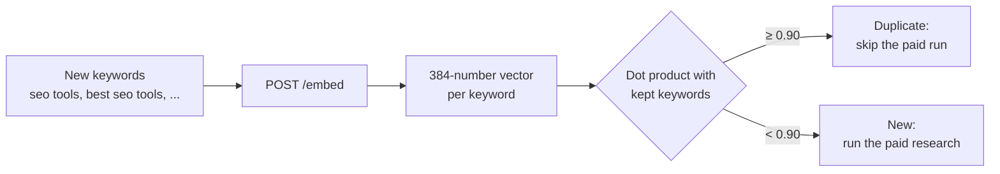

# Semantic Filter API

[](LICENSE)
[](https://www.python.org/)
[-B3A9FF.svg)](https://huggingface.co/BAAI/bge-small-en-v1.5)

A small, self-hosted API that turns short texts (keywords, titles) into **vectors**.
Compare two vectors and you know if two keywords mean the same thing.

Use it to catch near-duplicate keywords like **"seo tools"** and **"best seo tools"** in an
**n8n** workflow (or any script) **before** you pay a scraper or an SEO-data API to research
both. With the real model, these two score **0.954** out of 1.0. "seo tools" and
"how to bake bread" score **0.449**.

- **Your data stays home.** Keywords and vectors never leave your server.
- **No per-call cost.** No vendor bill, no vendor rate limit. It runs on CPU, no GPU.
- **One small container.** The model ([`BAAI/bge-small-en-v1.5`](https://huggingface.co/BAAI/bge-small-en-v1.5),
  MIT, 66.5 MB as ONNX) is baked into the image at build time. It never downloads at boot.
- **Safe defaults.** The token check fails closed: no token set means no access.

> How the project was built, step by step, and why: **[HOW-WE-BUILT-IT.md](HOW-WE-BUILT-IT.md)**.



---

## Contents

1. [Why this exists](#1-why-this-exists)
2. [Model and licenses](#2-model-and-licenses)
3. [Quick start with Docker](#3-quick-start-with-docker)
4. [Local development and tests](#4-local-development-and-tests)
5. [API reference](#5-api-reference)
6. [Similarity: how to compare vectors](#6-similarity-how-to-compare-vectors)
7. [Examples: n8n and Python](#7-examples-n8n-and-python)
8. [Deploy on your own VPS (Traefik + GitHub Actions)](#8-deploy-on-your-own-vps-traefik--github-actions)
9. [Costs and resources](#9-costs-and-resources)
10. [Security](#10-security)
11. [Troubleshooting: every problem and edge case we know](#11-troubleshooting-every-problem-and-edge-case-we-know)
12. [Project layout](#12-project-layout)
13. [Limits and what is not built](#13-limits-and-what-is-not-built)
14. [Credits and license](#14-credits-and-license)

---

## 1. Why this exists

- **Keyword lists repeat themselves.** Lists from many sources hold the same idea in many
  spellings: "seo tools", "best seo tools", "top seo tools", "seo tool".
- **Each paid run costs money.** A scraper run, a SERP API call or a keyword-data API call is
  billed per keyword or per run. Researching all four spellings buys the same answer four times.
- **Text matching does not catch it.** "seo tools" and "best seo tools" are different strings.
  An embedding sees that they mean the same thing.
- **Why self-host instead of an embeddings API:**
  - No cost per call, so you can embed every keyword, every time.
  - No vendor rate limit.
  - Your keyword lists stay private.
  - The model is pinned inside your image. A vendor cannot retire it, so old vectors stay
    comparable with new ones.
- **What it does not do:** it does not store vectors and does not compare them. It only
  turns text into vectors. Storing and comparing is the caller's job (an n8n Code node, a
  script, or a vector database like pgvector). That keeps the service small and stateless.

---

## 2. Model and licenses

The code in this repo is **Apache-2.0**. The model is **not** in this repo. It is downloaded
at image build time and keeps its own license.

| | |
|---|---|
| Model name | [`BAAI/bge-small-en-v1.5`](https://huggingface.co/BAAI/bge-small-en-v1.5) |
| Model license | **MIT** (commercial use allowed) |
| File actually downloaded | fastembed's ONNX build, [`Qdrant/bge-small-en-v1.5-onnx-Q`](https://huggingface.co/Qdrant/bge-small-en-v1.5-onnx-Q) → `model_optimized.onnx`, **66.5 MB** (also MIT). The original weights are about 130 MB. |
| Vector size | **384** numbers |
| Language | **English** |
| Longest input | **512 tokens**. Longer text is cut without a warning. |
| Vector length | **1.0** (L2-normalized), so a dot product is the cosine similarity |
| Runtime | [ONNX Runtime](https://onnxruntime.ai/) on CPU, through [fastembed](https://github.com/qdrant/fastembed). **No PyTorch**, which keeps the image and the RAM small. |

**Other models.** `EMBED_MODEL` takes any model name that fastembed supports. List them with:

```bash
.venv/bin/python -c "from fastembed import TextEmbedding; [print(m['model'], m['dim'], m['license']) for m in TextEmbedding.list_supported_models()]"
```

- For non-English keywords, a multilingual model such as
  `sentence-transformers/paraphrase-multilingual-MiniLM-L12-v2` (384 dims, Apache-2.0) is on
  that list. We did not test it here.
- **Changing the model is a rebuild**, not a restart. The model is baked at build time.
- **The thresholds in this README are for `bge-small-en-v1.5` only.** Measure again with a new model.
- **Vectors from different models never mix.** After a model change, embed everything you
  stored again.

---

## 3. Quick start with Docker

You need Docker. About 2 minutes for the first build on a fast line.

```bash
git clone https://github.com/rachid-log/semantic-filter-api.git
cd semantic-filter-api

cp .env.example .env
chmod 600 .env
# A random token, written straight into .env (never printed):
sed -i "s/^EMBED_API_TOKEN=.*/EMBED_API_TOKEN=$(openssl rand -hex 32)/" .env
# The build refuses any example.com address, so set a real one. Locally:
sed -i "s#^SITE_URL=.*#SITE_URL=http://localhost:8080#" .env

docker build --build-arg SITE_URL=http://localhost:8080 -t semantic-filter-api:latest .
docker run --rm -p 8080:8080 --env-file .env semantic-filter-api:latest
```

- The build downloads the model and **embeds a test sentence**. A broken model fails the build,
  not your first request. Look for `baked BAAI/bge-small-en-v1.5 dim=384` in the build log.
- **Measured:** the image is about **800 MB** on disk. A new container answers about
  **5 seconds** after `docker run`.

In a second terminal:

```bash
set -a && . ./.env && set +a          # loads EMBED_API_TOKEN without printing it

curl -s http://localhost:8080/api/health
# {"status":"ok","siteUrl":"http://localhost:8080","commit":"","model":"BAAI/bge-small-en-v1.5","dim":384,"auth":"configured"}

curl -s http://localhost:8080/embed \
  -H "Authorization: Bearer $EMBED_API_TOKEN" \
  -H "Content-Type: application/json" \
  -d '{"texts": ["seo tools", "best seo tools"]}' | head -c 200
# {"model":"BAAI/bge-small-en-v1.5","dim":384,"count":2,"embeddings":[[-0.0412...
```

`docker compose up` is for a server with Traefik (see [section 8](#8-deploy-on-your-own-vps-traefik--github-actions)).
It needs Traefik's external network, so use `docker run` on your laptop.

---

## 4. Local development and tests

Python **3.12** (what the image and CI use). With [`uv`](https://docs.astral.sh/uv/):

```bash
uv venv --python 3.12 .venv
uv pip install --python .venv/bin/python -r requirements-dev.txt

EMBED_API_TOKEN=dev .venv/bin/pytest          # 8 tests against the REAL model
.venv/bin/ruff check .                        # lint

EMBED_API_TOKEN=dev .venv/bin/uvicorn app.main:app --port 8080   # run it
```

Without uv: `python3.12 -m venv .venv && .venv/bin/pip install -r requirements-dev.txt`.

- **The tests use the real model, not a mock.** The first run downloads it once (66.5 MB).
  A broken fastembed version fails here.
- **Where the model goes:** fastembed's default cache is your system temp folder
  (`/tmp/fastembed_cache` on Linux). Many systems empty `/tmp` at reboot, so it downloads
  again. Set `FASTEMBED_CACHE_PATH=.fastembed-cache` to keep it in the project
  (it is git-ignored). CI does the same and caches the folder.
- **What the 8 tests check:** health is open and flat; health answers `HEAD`; `/` names the
  service; `/embed` refuses a missing or wrong token; vector shape; empty batch → 422;
  oversize batch → 413 (`MAX_BATCH` is forced to 8 in the tests); and
  **"seo tools" vs "best seo tools" must score above 0.8 and far above "chocolate cake recipe"**.
- **CI** ([`.github/workflows/ci.yml`](.github/workflows/ci.yml)) runs ruff, the tests and a
  real `docker build` on every push and pull request.

### Settings (environment variables)

| Variable | Default | When it is read | What it does |
|---|---|---|---|
| `EMBED_API_TOKEN` | none | runtime | Bearer token for `POST /embed`. **Unset = every call gets 503** (fail closed). Secret: never a build arg. |
| `SITE_URL` | none | **build** + runtime | Public origin, no trailing slash. Baked into `robots.txt` and shown by `/api/health`. The build refuses `example.com` and anything that is not `http(s)://…`. |
| `EMBED_MODEL` | `BAAI/bge-small-en-v1.5` | **build** + runtime | The model baked into the image. |
| `MAX_BATCH` | `256` | runtime | Most texts per call. More → 413. |
| `GIT_SHA` | empty | **build** | Commit shown by `/api/health` (first 12 characters). CI fills it. |
| `OMP_NUM_THREADS` | `2` (set in the image) | runtime | CPU threads ONNX may use. Keeps one service from taking every core. |
| `FASTEMBED_CACHE_PATH` | `/opt/fastembed-cache` in the image | runtime | Where the baked model lives. Do not change it in the container. |

---

## 5. API reference

Base URL: your domain (for example `https://embed.example.com`), or `http://localhost:8080`.
Interactive docs (`/docs`, `/redoc`) are **turned off** and answer 404.

| Method | Path | Auth | What it does |
|---|---|---|---|
| `GET` | `/` | none | Lists the routes. |
| `GET`, `HEAD` | `/api/health` | none | Up check. Used by Docker's healthcheck and the deploy guard. |
| `POST` | `/embed` | **Bearer token** | Texts in, vectors out. |
| `GET` | `/robots.txt` | none | `Disallow: /` plus the `Host:` line baked at build time. |

### Authentication

```http
Authorization: Bearer <EMBED_API_TOKEN>
```

- The word `Bearer` is not case-sensitive (`bearer` works). Any other scheme gets 401.
- The token is compared in constant time (`secrets.compare_digest`), so timing does not leak it.
- If the server has no token set, `/embed` answers **503**, never "open to all".

### `GET /`

```json
{"service": "semantic-filter-api", "health": "/api/health", "embed": "POST /embed"}
```

This route answers `GET` only. **`HEAD /` (for example `curl -I`) gives 405.** Use
`/api/health` for checks.

### `GET /api/health` and `HEAD /api/health`

```json
{
  "status": "ok",
  "siteUrl": "https://embed.example.com",
  "commit": "1a2b3c4d5e6f",
  "model": "BAAI/bge-small-en-v1.5",
  "dim": 384,
  "auth": "configured"
}
```

| Field | Meaning |
|---|---|
| `status` | `"ok"` when the model is loaded. Uvicorn only opens the port after the model loads, so a server that answers says `"ok"`. |
| `siteUrl` | `SITE_URL` as the running process reads it. |
| `commit` | First 12 characters of `GIT_SHA`. Empty when built without it. |
| `model` | `EMBED_MODEL`. |
| `dim` | Vector size the loaded model returns (384). |
| `auth` | `"configured"` or `"missing"`. **It never shows the token.** |

- **Flat JSON on purpose.** The deploy guard reads it with `grep` and `cut`, not a JSON parser.
  Do not nest it.
- **`HEAD` is on purpose.** Docker's `HEALTHCHECK` uses `wget --spider`, which sends `HEAD`.
  FastAPI does not answer `HEAD` on a `GET`-only route, so without it the container never
  becomes healthy.

### `POST /embed`

Request:

```json
{"texts": ["seo tools", "best seo tools"]}
```

| Field | Type | Rule |
|---|---|---|
| `texts` | list of strings | 1 to `MAX_BATCH` (default 256) items. Order is kept. |

Response `200`:

```json
{
  "model": "BAAI/bge-small-en-v1.5",
  "dim": 384,
  "count": 2,
  "embeddings": [
    [-0.0412, -0.0559, 0.0183, 0.0007, "... 380 more numbers"],
    ["... 384 numbers for 'best seo tools'"]
  ]
}
```

(The first 4 numbers for "seo tools" are real, rounded to 4 places.)

- `embeddings[i]` is the vector for `texts[i]`.
- Each vector has length 1.0. **Dot product = cosine similarity.**
- **Size:** about **8 KB of JSON per text.** 256 texts ≈ **2 MB** per response.
- **An empty string `""` is not refused.** It gets a vector like any text. Filter blanks
  before you call.
- **Text over 512 tokens is cut** without a warning. Send short texts (keywords, titles).
- **No cache.** The same text sent twice is embedded twice.

### Errors

| Code | When | Body |
|---|---|---|
| **401** | Header missing, scheme not `Bearer` (for example `Token x`), or wrong token | `{"detail": "invalid bearer token"}` |
| **413** | More texts than `MAX_BATCH` | `{"detail": "batch of 300 exceeds MAX_BATCH=256"}` |
| **422** | `texts` is an empty list | `"msg": "List should have at least 1 item after validation, not 0"` |
| **422** | `texts` is one string, not a list (`"texts": "seo tools"`) | `"msg": "Input should be a valid list"` |
| **422** | Key is missing or misspelled (`"text": …`) | `"msg": "Field required"` |
| **422** | A number or `null` in the list | `"msg": "Input should be a valid string"` |
| **503** | Server started without `EMBED_API_TOKEN` | `{"detail": "EMBED_API_TOKEN not configured"}` |
| **503** | Model not loaded (should not happen once the port is open) | `{"detail": "model not loaded yet"}` |
| **405** | `HEAD /` (for example `curl -I https://…/`) | `{"detail": "Method Not Allowed"}` |
| **500** | `GET /robots.txt` when run **outside Docker** (the file is made at image build) | Internal Server Error |

The token is checked **before** the body. A bad token with a bad body gets 401.

---

## 6. Similarity: how to compare vectors

Vectors have length 1.0, so the **dot product is the cosine similarity**:

$$\text{similarity}(A, B) = \sum_{i=1}^{384} A_i \cdot B_i$$

1.0 means "the same". Higher means closer.

### Real scores from this model

Measured with `BAAI/bge-small-en-v1.5` through `POST /embed`:

| "seo tools" vs | Score | What to do |
|---|---|---|
| "seo tool" | **0.977** | Duplicate. Skip. |
| "best seo tools" | **0.954** | Duplicate. Skip. |
| "top seo tools" | **0.944** | Duplicate. Skip. |
| "seo tools free" | **0.913** | Duplicate by score. But "free" can be its own intent. Check by hand. |
| "seo software" | **0.863** | Judgment call. |
| "free seo software" | **0.826** | Related, different keyword. Keep. |
| "seo audit" | **0.779** | Related, different keyword. Keep. |
| "keyword research tool" | **0.777** | Related, different keyword. Keep. |
| "backlink checker" | **0.696** | Related, different keyword. Keep. |
| "plumbing" | **0.540** | Different topic. |
| "how to bake bread" | **0.449** | Different topic. |
| "chocolate cake recipe" | **0.416** | Different topic. |

Other pairs: "best seo tools" vs "top seo tools" **0.974**. "keyword research tool" vs
"keyword research tools" **0.982**.

### Thresholds

| Score | Meaning | Action |
|---|---|---|
| **≥ 0.90** | Near-duplicate | Skip the paid run |
| **0.85 – 0.90** | Grey zone | Your call, or a human check |
| **0.60 – 0.85** | Same field, different keyword | Keep |
| **< 0.60** | Different topic | Keep |

- **Unrelated English text still scores about 0.4–0.55 with this model**, never near 0.
  Do not read 0.5 as "half the same".
- **Small words can carry intent.** "free", "cheap", "near me" change what a searcher wants
  but move the score only a little ("seo tools free" = 0.913). Check a sample of merges by
  hand before you trust a threshold with money.
- **Scores can differ a little in the last decimals** between runs or batch sizes. The
  3-decimal values above were the same in every run we did (local, in Docker, alone or in a
  batch).

---

## 7. Examples: n8n and Python

### n8n: skip near-duplicates before a paid run

Four nodes. Input: one item per keyword, with the keyword in `json.keyword`.

**1. Code node "Batch keywords"** (Run Once for All Items). Packs keywords into chunks of
256, the default `MAX_BATCH`:

```javascript
const all = $input.all()
  .map(i => String(i.json.keyword ?? '').trim())
  .filter(k => k.length > 0);               // "" would still get a vector
const size = 256;                            // = MAX_BATCH on the server
const out = [];
for (let i = 0; i < all.length; i += size) out.push({ json: { texts: all.slice(i, i + size) } });
return out;
```

**2. HTTP Request node "Embed"**
- Method `POST`, URL `https://embed.example.com/embed`.
- Authentication: Generic Credential Type → **Header Auth**. Name `Authorization`, value
  `Bearer <your token>`.
- Send Body: JSON → Using JSON → `{{ JSON.stringify({ texts: $json.texts }) }}`.
- It runs once per chunk and keeps the order.

**3. Code node "Dedupe"** (Run Once for All Items):

```javascript
const THRESHOLD = 0.90;
const texts = $('Batch keywords').all().flatMap(i => i.json.texts);
const vectors = $input.all().flatMap(i => i.json.embeddings);

function dot(a, b) {
  let s = 0;
  for (let i = 0; i < a.length; i++) s += a[i] * b[i];
  return s;
}

const kept = [];   // keywords we will pay to research
const out = [];
texts.forEach((keyword, i) => {
  let best = { score: 0, keyword: null };
  for (const k of kept) {
    const s = dot(vectors[i], k.vector);
    if (s > best.score) best = { score: s, keyword: k.keyword };
  }
  const duplicate = best.score >= THRESHOLD;
  if (!duplicate) kept.push({ keyword, vector: vectors[i] });
  out.push({ json: { keyword, duplicate, duplicateOf: duplicate ? best.keyword : null,
                     score: Number(best.score.toFixed(3)) } });
});
return out;
```

**4. IF node:** `{{ $json.duplicate }}` is false → your paid scraper or API node.

- With "seo tools", "best seo tools", "keyword research tool", the second one comes out as
  `duplicate: true, duplicateOf: "seo tools", score: 0.954`.
- **To dedupe against earlier runs**, store the kept keywords and vectors (an n8n Data
  Table, Postgres, pgvector) and add them to `kept` before the loop. The service stores
  nothing.
- **This loop compares every pair.** It is fine for hundreds or a few thousand keywords. For
  tens of thousands, use a vector database (pgvector) instead.

### Python

```python
import os
import requests

URL = "https://embed.example.com"
H = {"Authorization": f"Bearer {os.environ['EMBED_API_TOKEN']}"}

keywords = ["seo tools", "best seo tools", "keyword research tool", "how to bake bread"]
r = requests.post(f"{URL}/embed", json={"texts": keywords}, headers=H, timeout=30)
r.raise_for_status()
vecs = r.json()["embeddings"]

def dot(a, b):
    return sum(x * y for x, y in zip(a, b))

for kw, v in zip(keywords[1:], vecs[1:]):
    print(f"{dot(vecs[0], v):.3f}  seo tools vs {kw}")
# 0.954  seo tools vs best seo tools
# 0.777  seo tools vs keyword research tool
# 0.449  seo tools vs how to bake bread
```

With numpy, all pairs at once: `M = np.array(vecs); S = M @ M.T`.

### curl

```bash
curl -sS -w "\nHTTP %{http_code}\n" https://embed.example.com/embed \
  -H "Authorization: Bearer $EMBED_API_TOKEN" \
  -H "Content-Type: application/json" \
  -d '{"texts": ["seo tools", "best seo tools"]}'
```

Use `-sS`, not `-s`. Plain `-s` also hides curl's own errors, so a failed call prints nothing.

---

## 8. Deploy on your own VPS (Traefik + GitHub Actions)

A push to `main` → GitHub Actions renders `.env` from your repository secrets → connects to
the VPS over SSH → builds the new image **while the old container still serves** → swaps the
container → **checks that the running container is the one it just built**.

In the examples, `203.0.113.10` (a documentation IP), `embed.example.com` and the user
`deploy` are placeholders. Use your own.

### 8.1 What you need

- A Linux VPS with Docker and Docker Compose v2. **2 GB of RAM is enough.** The service
  uses about 245–350 MB (see [section 9](#9-costs-and-resources)).
- **Traefik already running on that server.** It owns ports 80 and 443, gets Let's Encrypt
  certificates, and has an external Docker network that this stack can join.
  - This repo assumes the network is called **`root_default`** and the certificate resolver
    **`mytlschallenge`**. If yours have other names, change them in
    [`docker-compose.yml`](docker-compose.yml) (3 places).
  - It assumes Traefik already redirects HTTP to HTTPS for every host. If not, add that
    redirect in Traefik's config.
- A domain name you control.
- Your own GitHub copy of this repo (a fork, or a new repo).

### 8.2 DNS first

Add an `A` record: `embed.example.com → 203.0.113.10`. Then check it **before** the first deploy:

```bash
dig +short embed.example.com        # must print 203.0.113.10
```

**Order matters on a new hostname.** Traefik asks for the certificate as soon as the
container appears. If DNS does not answer yet:
- Let's Encrypt fails with `NXDOMAIN`.
- Traefik falls back to its own `TRAEFIK DEFAULT CERT` (browsers warn).
- Traefik does not retry on its own. Fix DNS, then `./scripts/vps.sh restart`.
- A failed DNS lookup can stay cached for about an hour.
- Let's Encrypt allows **5 failed validations per hostname per hour**.

### 8.3 Set your hostname in the repo

It lives in **two places**. They must match:

1. [`docker-compose.yml`](docker-compose.yml): ``Host(`embed.example.com`)``
2. `SITE_URL` in [`.env.example`](.env.example), or a `SITE_URL` repository secret
   (the secret wins).

**The image build refuses any `example.com` value.** That is on purpose: a forgotten
placeholder fails the build, not production. Changing the hostname later is a **rebuild**
(a deploy), not a restart.

### 8.4 Server user and SSH key

Use a deploy-only key. Do not reuse your personal key.

```bash
# On your machine
ssh-keygen -t ed25519 -C "deploy@semantic-filter-api" -f ~/.ssh/semantic-filter-api-deploy
ssh-copy-id -i ~/.ssh/semantic-filter-api-deploy.pub -p 22 deploy@203.0.113.10

# On the server: the deploy user must be able to run Docker
sudo usermod -aG docker deploy
```

- The pipeline clones the repo into **`$HOME/semantic-filter-api`** of that user.
- Being in the `docker` group is the same as being root on that server. Treat this key
  with care.
- **One key per machine.** If a laptop is stolen, you delete one line in the server's
  `~/.ssh/authorized_keys`. The other machines keep working.

### 8.5 GitHub secrets and the deploy switch

`Settings → Secrets and variables → Actions`.

**First, the switch.** Under **Variables**, add `DEPLOY_ENABLED` = `true`. Without it the
deploy job is **skipped** (grey, not red). That keeps forks and the public repo from failing
on every push.

Then under **Repository secrets** (secrets, not Variables: the workflow reads the `secrets`
context, which cannot see Variables):

| Secret | Required | What it is |
|---|---|---|
| `HOST_IP_ADDRESS` | **yes** | Server IP, for example `203.0.113.10` |
| `HOST_ROOT_NAME` | **yes** | SSH user, for example `deploy`. (The name says ROOT for historical reasons. Any user with Docker access works.) |
| `HOST_SSH_KEY` | **yes** | The **whole private key file**, header and footer lines included |
| `EMBED_API_TOKEN` | **yes** | The API token. Make one with `openssl rand -hex 32`. It ships as `__REQUIRED__`, and the deploy fails without it. |
| `SITE_URL` | **yes, unless** you edited `.env.example` | `https://embed.yourdomain.com`. The build refuses the `example.com` placeholder. |
| `SSH_PORT` | no | Default `22` |
| `GH_PAT` | **only for a private repo** | GitHub token, fine-grained, **Contents: Read-only**, this repo only. A public repo needs none. |
| `EMBED_MODEL` | no | Another fastembed model. Build time: it re-downloads during the build. |
| `MAX_BATCH` | no | Default `256` |

**How `.env` is made:** the workflow reads `.env.example` line by line. If a secret has the
same name as a key, the secret's value replaces it. Other keys keep the committed value.
Then it **fails the deploy if any `KEY=…__REQUIRED__` line is left**, so a forgotten secret
never ships as a placeholder. `GIT_SHA` comes from the commit being deployed.

> **Secret caveat.** The rendered `.env` travels to the server base64-encoded inside a step
> output. Base64 defeats GitHub's automatic secret masking. Never add a step that prints
> `ENV_CONTENT`, and keep the SSH action's debug output off.

### 8.6 Before the first deploy: check memory

```bash
free -m
docker stats --no-stream
```

The image is **built on the server**. The build installs packages and downloads the model.
If RAM is tight, add a swap file. Building on the server is what makes rollback instant: the
old image stays there as `semantic-filter-api:previous`.

### 8.7 Deploy

Push to `main`. Or: `Actions → Deploy to VPS → Run workflow`.

What the remote script does, in order (`set -e`: it stops at the first error):

1. `git fetch --depth 1` + `git reset --hard FETCH_HEAD` (sync in place).
   `git clean -fd` removes stray files but **keeps git-ignored ones like `.env`**.
   (`-fdx` would delete `.env`.)
2. Writes `.env` from the secrets, `chmod 600`.
3. Tags the running image `semantic-filter-api:previous` (for rollback).
4. `docker compose build`. **The old container still serves.** A build error stops here,
   and the live service is untouched.
5. `docker compose up -d --force-recreate semantic-filter-api` (the swap).
6. **The artifact guard** (below).
7. `docker image prune -f`: removes dangling layers only.

**Downtime** is the swap plus the model load: about 5 seconds in our test.

### 8.8 The artifact guard

A container can look healthy (200s, valid certificate) while it runs an **old build**. The
guard checks what the running container actually serves against the `.env` it just wrote:

| Check | Read from | Proves |
|---|---|---|
| Domain, baked | `robots.txt` → `Host:` line | What was **built** into the image |
| Domain, runtime | `/api/health` → `siteUrl` | What the **running process** reads |
| Commit | `/api/health` → `commit` | The container runs **this** commit |
| Token present | `/api/health` → `auth` = `configured` | `/embed` will not answer 503 to everyone |
| Model | `/api/health` → `model` | No stale image with another model (mixed vectors break dedupe) |

It waits up to 30 seconds for an answer. On any mismatch it prints the rollback command and
the job fails.

### 8.9 Check it

```bash
curl -s https://embed.example.com/api/health
./scripts/vps.sh health      # container health + /api/health inside the container + public check
./scripts/vps.sh cert        # want: O = Let's Encrypt
```

On the server:

```bash
cd ~/semantic-filter-api
docker compose ps
docker inspect -f '{{.State.Health.Status}}' semantic-filter-api      # want: healthy
docker exec semantic-filter-api wget -qO- http://127.0.0.1:8080/api/health
docker exec semantic-filter-api wget -qO- http://127.0.0.1:8080/robots.txt
docker logs --tail=200 <your-traefik-container> 2>&1 | grep -iE "acme|error|semantic-filter-api"
```

`issuer=CN = TRAEFIK DEFAULT CERT` means the certificate request failed. Read Traefik's log,
fix the cause (usually DNS), then `./scripts/vps.sh restart`.

### 8.10 Rollback

```bash
./scripts/vps.sh rollback
# or on the server:
cd ~/semantic-filter-api
docker image tag semantic-filter-api:previous semantic-filter-api:latest
docker compose up -d --force-recreate semantic-filter-api
```

The `:previous` tag lives until the next deploy. `docker system prune -a` would delete it.
That is why the pipeline only runs `docker image prune -f`.

### 8.11 Manual ops from your machine

[`scripts/deploy.sh`](scripts/deploy.sh) runs the same deploy by hand.
[`scripts/vps.sh`](scripts/vps.sh) has the day-to-day commands. Both read the server details
from `.env.deploy`, or from variables exported in your shell:

```bash
cp .env.deploy.example .env.deploy && chmod 600 .env.deploy    # then fill it in
# or, from your secret store, for one command only:
#   export VPS_HOST=203.0.113.10 VPS_USER=deploy GH_REPO=you/semantic-filter-api
```

| Command | What it does |
|---|---|
| `./scripts/deploy.sh` | Deploys `main` as it is on GitHub, same steps and same guard |
| `./scripts/deploy.sh --ref BRANCH` | Deploys another branch |
| `./scripts/deploy.sh --push-env` | **Also** uploads your local `.env`. It asks first and refuses `__REQUIRED__` values. |
| `./scripts/vps.sh health` | Container health, `/api/health`, public check |
| `./scripts/vps.sh ps` / `logs` / `restart` | `docker compose ps`, follow logs, restart |
| `./scripts/vps.sh rollback` | Back to `:previous` (asks first) |
| `./scripts/vps.sh cert` | Certificate issuer and dates |
| `./scripts/vps.sh traefik` | Traefik's log lines about ACME and errors. Set `TRAEFIK_CONTAINER` if yours is not `root-traefik-1`. |
| `./scripts/vps.sh ssh [cmd]` | A shell, or one command, in the app folder |

- **`.env` and `.env.deploy` are separate on purpose.** `.env` goes into the running
  container. If the server address, SSH key path and a GitHub token sat there, a bug in the
  app could hand over the whole server. `.env.deploy` stays on your machine only and is kept
  out of the Docker build.
- **A normal deploy needs no local setup.** GitHub Actions holds every secret. A fresh clone
  deploys with a plain `git push`.

### 8.12 Build time vs runtime

- **Baked at build:** the model, and the `robots.txt` `Host:` line (from `SITE_URL`).
  Changing `SITE_URL` or `EMBED_MODEL` on a running container does nothing. They need an
  `ARG`/`ENV` pair in the Dockerfile **and** a `build.args` line in `docker-compose.yml`, and a
  rebuild.
- **Read at runtime:** the token and `MAX_BATCH`, through `env_file`.
- **Secrets are never build args.** Build args stay readable forever with `docker history`.

---

## 9. Costs and resources

- **No per-call fee.** You pay for a server you probably already have. The saving is every
  paid research run you skip.
- **CPU only.** No GPU.

Measured on a laptop CPU, in the Docker image, with `OMP_NUM_THREADS=2` (median of 5 calls,
short keywords, over HTTP):

| What | Measured |
|---|---|
| Image size on disk | about **800 MB** |
| Model download at build | **66.5 MB** |
| New container → first answer | about **5 s** |
| RAM, idle after start | about **245 MB** |
| RAM after 256-text batches | about **350 MB** |
| 1 text | about **28 ms** |
| 50 texts | about **210 ms** |
| 256 texts | about **720 ms** |
| Response size | about **8 KB per text** (2 MB for 256) |

- A VPS core can be slower than a laptop core. Measure on your server.
- **Throughput comes from batching**, not from more workers. One uvicorn worker with 2
  threads is on purpose: embedding is CPU work, and the service shares a small (2 GB) server
  with other apps.
- **Disk:** the image, plus logs capped at 3 × 10 MB.

---

## 10. Security

- **Fail closed.** No token set → `/embed` answers 503. It is never open by accident.
- **Constant-time compare** (`secrets.compare_digest`) for the token.
- **Open routes show no secrets.** `/api/health` says `auth: "configured"` or `"missing"`,
  never the value. It does show the model, the commit and `SITE_URL`.
- **No `/docs`.** Interactive docs are off.
- **`robots.txt` says `Disallow: /`.** It keeps polite crawlers out. It is not access control.
- **The token is runtime-only.** It reaches the container through `env_file`, never as a build
  arg (build args stay readable with `docker history`). `.env` is `chmod 600` and git-ignored.
  The `.dockerignore` keeps `.env` and `.env.deploy` out of the Docker build context.
- **The container runs as a non-root user** (uid 1001).
- **No rate limit, one shared token.** Anyone with the token can use your CPU. They cannot
  read anything: the service stores nothing. Add a Traefik rate-limit middleware before you
  hand the token to anything you trust less than your own workflows.
- **Keep the URL private anyway.** It costs nothing to hide.
- **Rotate the token** if it leaks:
  1. Make a new one: `openssl rand -hex 32`.
  2. Replace the `EMBED_API_TOKEN` repository secret.
  3. Deploy (push or Run workflow).
  4. Update every caller (the n8n Header Auth credential, scripts).
  There is no overlap window: the old token stops working at the swap.
- **Deploy secrets:** a deploy-only SSH key, a read-only GitHub token (only for a private repo),
  and the base64 masking caveat in [8.5](#85-github-secrets-and-the-deploy-switch).

---

## 11. Troubleshooting: every problem and edge case we know

### Build and deploy

| Symptom | Cause | Fix |
|---|---|---|
| Build fails at the `static/robots.txt` step, `exit code: 1` | `SITE_URL` is the `example.com` placeholder, empty, or not `http(s)://…` | Set your real URL in `.env` / the `SITE_URL` secret / `--build-arg SITE_URL=…` |
| `SITE_URL missing from .env` on `docker compose build` | Compose's `:?` guard | Add `SITE_URL` to `.env` |
| Deploy fails: "The keys above are still placeholders" | A `__REQUIRED__` key has no repository secret (usually `EMBED_API_TOKEN`) | Add the secret, re-run |
| The deploy job is **skipped** | `DEPLOY_ENABLED` variable not set to `true` | Add it under Actions → **Variables** |
| A secret seems ignored | It was added as a **Variable**, not a secret | Move it to Repository **secrets** |
| SSH step fails to log in | Key pasted without its header and footer lines, or the public key is not on the server | Paste the whole private key file. Check `~/.ssh/authorized_keys` of the user |
| `docker: permission denied` on the server | The deploy user is not in the `docker` group | `sudo usermod -aG docker deploy`, then log in again |
| `could not resolve main` (manual deploy) or fetch fails | Private repo and no `GH_PAT` | Set `GH_PAT` (Contents: Read-only) |
| "NO HEALTH RESPONSE" in the deploy log | The container crashed, or answered an error. `wget` hides the body on non-2xx, so both look the same. | Read the container log lines printed under it |
| COMMIT / DOMAIN / MODEL MISMATCH | The running container is not the image just built, or `SITE_URL` changed without a rebuild | Run the printed rollback command, find the cause, deploy again |
| "EMBED_API_TOKEN MISSING" | The container got no token | Set the secret, deploy again |
| Container never becomes healthy (if you change the health route) | Docker's healthcheck uses `wget --spider`, which sends `HEAD`. A `GET`-only FastAPI route answers 405. | Keep `HEAD` on `/api/health` (`methods=["GET", "HEAD"]`) |
| Browser warns, `issuer=CN = TRAEFIK DEFAULT CERT` | Certificate request failed, usually DNS not ready | Fix DNS, wait, `./scripts/vps.sh restart`. Max 5 failed tries per hostname per hour |
| Requests through Traefik time out | The container is on two networks and Traefik picked the private one | Keep the `traefik.docker.network` label |
| Traefik shows a router conflict, or `docker` says the name is in use | Router and container names are global on the server | Give each stack unique names |
| `network root_default not found` on `docker compose up` | That network exists only on your server (Traefik's) | Locally use `docker run`. On the server, use your Traefik network's name |
| `.env` vanished on the server | Someone ran `git clean -fdx` | The pipeline uses `-fd`. Deploy again (it writes `.env`) |
| The rollback image is gone | `docker system prune -a` deleted `:previous` | Only use `docker image prune -f` |
| Server disk full | Container logs without rotation | Keep the `logging` block (3 × 10 MB) in `docker-compose.yml` |
| Model files: `Permission denied` at runtime | The cache was written as root at build, and the app runs as uid 1001 | Keep the `chown … /opt/fastembed-cache` line in the Dockerfile |

### API calls

| Symptom | Cause | Fix |
|---|---|---|
| 401 `invalid bearer token` | Header missing, scheme is not `Bearer`, wrong token, or token rotated | `Authorization: Bearer <token>`. Load the current token |
| 503 `EMBED_API_TOKEN not configured` | Server started without a token (fail closed) | Set `EMBED_API_TOKEN` and restart |
| 413 `batch of N exceeds MAX_BATCH=256` | Too many texts in one call | Send chunks of 256 or fewer. You can raise `MAX_BATCH`, but watch RAM |
| 422 `List should have at least 1 item` | Empty `texts` list | Skip the call when there is nothing to embed |
| 422 `Input should be a valid list` | Sent `"texts": "seo tools"` (a string) | Wrap it: `["seo tools"]` |
| 422 `Field required` | Key misspelled (`text`) | Use `texts` |
| 422 `Input should be a valid string` | A number or `null` in the list | Turn values into strings, drop nulls |
| `curl -I https://…/` says **405** | `/` answers `GET` only | Use `curl -I https://…/api/health`, or `curl -s` without `-I` |
| `/robots.txt` gives **500** on your laptop | The file is made at image build, so it does not exist outside Docker | Use the Docker image. Only the deploy guard reads it |
| `/docs` gives 404 | Interactive docs are off on purpose | Use this README |
| `curl -s` prints nothing | `-s` hides curl's own errors | Use `curl -sS -w "\nHTTP %{http_code}\n"` |
| The server uses 100% of every core | ONNX uses all cores by default | `OMP_NUM_THREADS=2` is set in the image. Use `1` on a very small server |

### Similarity results

| Symptom | Cause | Fix |
|---|---|---|
| Unrelated texts score 0.4–0.55, never near 0 | Normal for this model | Use the thresholds in [section 6](#6-similarity-how-to-compare-vectors) |
| "seo tools free" is merged into "seo tools" (0.913) | Modifiers like free / cheap / near me move the score only a little | Check merges by hand, raise the threshold, or keep modifier keywords out of the dedupe |
| Dedupe gives nonsense after a model change | Vectors from different models never mix | Embed everything stored again with the new model |
| Changed `EMBED_MODEL`, health still shows the old one | It is a build-time value | Rebuild (deploy). The guard reports MODEL MISMATCH otherwise |
| An empty line got a vector and matched something | `""` is not refused | Filter blank texts before the call |
| A long text matches oddly | Input over 512 tokens is cut | Embed short texts: keywords, titles |

### Local development

| Symptom | Cause | Fix |
|---|---|---|
| `ModuleNotFoundError: No module named 'app'` in pytest | Plain `pytest` does not put the repo root on `sys.path` | Fixed in this repo: `pythonpath = ["."]` in `pyproject.toml`. Or run `python -m pytest` |
| `StarletteDeprecationWarning: Using httpx with starlette.testclient is deprecated` | Newer Starlette versions | Harmless. The tests still pass |
| The model downloads again after a reboot | fastembed's default cache is in `/tmp` | Set `FASTEMBED_CACHE_PATH=.fastembed-cache` |
| A new container answers after about 5 s, not at once | It loads the baked model and runs one warm-up embed before opening the port | Normal. The healthcheck allows a 30 s start period |

---

## 12. Project layout

| File | Role |
|---|---|
| [`app/main.py`](app/main.py) | The service: routes, token check, model loading, batch cap |
| [`tests/test_api.py`](tests/test_api.py) | 8 tests against the real model |
| [`Dockerfile`](Dockerfile) | 3 stages: packages → **bake the model** → run as non-root on :8080 |
| [`docker-compose.yml`](docker-compose.yml) | Traefik labels, networks, log rotation, build args |
| [`.env.example`](.env.example) | The settings schema. The deploy renders `.env` from it |
| [`.env.deploy.example`](.env.deploy.example) | Server access placeholders, for manual ops only |
| [`.github/workflows/ci.yml`](.github/workflows/ci.yml) | ruff + pytest (real model) + image build, on every push and PR |
| [`.github/workflows/deploy.yml`](.github/workflows/deploy.yml) | The deploy pipeline and the artifact guard (opt-in with `DEPLOY_ENABLED`) |
| [`scripts/deploy.sh`](scripts/deploy.sh) | The same deploy, by hand |
| [`scripts/vps.sh`](scripts/vps.sh) | health, logs, restart, rollback, cert, traefik, ssh |
| [`scripts/lib/deploy-env.sh`](scripts/lib/deploy-env.sh) | Loads server access from `.env.deploy` or your shell |
| [`.intropera.json`](.intropera.json) + [`.intropera/`](.intropera/) | Project card for [intropera.com](https://intropera.com) |
| [`media/`](media/) | Social images, and [`media/build_media.py`](media/build_media.py) that renders them |
| [`HOW-WE-BUILT-IT.md`](HOW-WE-BUILT-IT.md) | The build journey, step by step |

`API.md` and `DEPLOYMENT.md` are short pointers to this README.

---

## 13. Limits and what is not built

- **No rate limiting.** One shared token, no per-caller quota.
- **One uvicorn worker.** On purpose, see [section 9](#9-costs-and-resources). Batch your calls.
- **No vector storage.** The service only computes vectors. Storing and comparing is the
  caller's job (a Code node today, pgvector later).
- **Manual token rotation, no overlap.** See [section 10](#10-security).
- **English model by default.** See [section 2](#2-model-and-licenses) for other languages.

---

## 14. Credits and license

- **Code:** Apache-2.0, © 2026 Rachid Ait Mohand. See [LICENSE](LICENSE) and [NOTICE](NOTICE).
- **Model:** [BAAI/bge-small-en-v1.5](https://huggingface.co/BAAI/bge-small-en-v1.5) by the
  Beijing Academy of Artificial Intelligence (MIT). ONNX build:
  [Qdrant/bge-small-en-v1.5-onnx-Q](https://huggingface.co/Qdrant/bge-small-en-v1.5-onnx-Q) (MIT).
  Downloaded at build time, not stored in this repo.
- **Libraries:** [fastembed](https://github.com/qdrant/fastembed) (Apache-2.0),
  [FastAPI](https://fastapi.tiangolo.com/) (MIT), [ONNX Runtime](https://onnxruntime.ai/) (MIT),
  [uvicorn](https://www.uvicorn.org/) (BSD-3-Clause).
